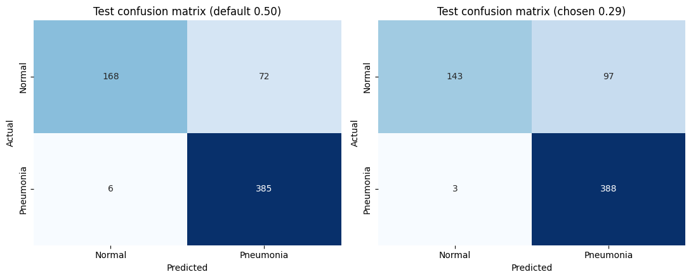
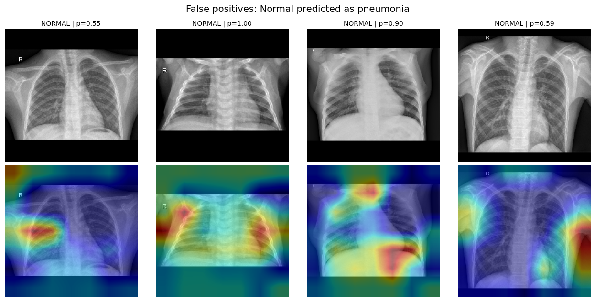
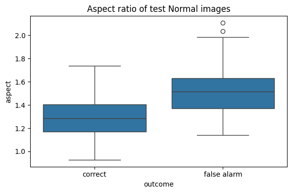
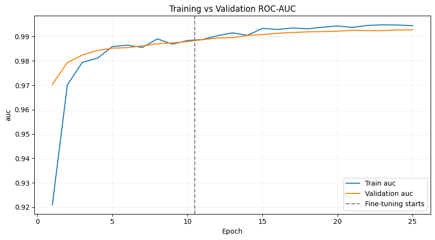

# Pneumonia Chest X-ray Classification

Deep learning model that classifies chest X-ray images as **Normal** or **Pneumonia**, built with EfficientNetB0 transfer learning (TensorFlow / Keras) on Google Colab.
The project goes beyond training a model: it uses a **patient-level split**, reports **confidence intervals**, and **investigates why the model over-calls pneumonia** on the test set.

> Educational project (DataMites capstone PRAICP-1012). **Not a diagnostic tool.**

## Results (test set: 631 images, never used for training or tuning)

| Setting | Recall | Specificity | Precision | Accuracy | F1 | ROC-AUC |
|---|---|---|---|---|---|---|
| Threshold 0.50 | **0.985** | 0.700 | 0.843 | 0.876 | 0.908 | **0.962** |
| Threshold 0.29 (chosen on validation) | 0.992 | 0.596 | 0.800 | 0.842 | 0.886 | 0.962 |

- Recall (the priority, since a missed pneumonia case is worse than a false alarm): **385 of 391 pneumonia cases found** at 0.50.
- 95% confidence intervals (patient-level bootstrap): AUC 0.944 to 0.976; at 0.50, recall 0.971 to 0.995 and specificity 0.637 to 0.760.
- Recall is similar for bacterial (0.984, 239 of 243) and viral (0.986, 146 of 148) pneumonia.
- Validation AUC was 0.993, so test performance is clearly lower than validation performance (see below).



## What makes this project different

1. **Patient-level split.** The dataset has several X-rays per patient, so a random split would leak near-identical images between train and validation. Images are grouped by patient, 27 duplicate images were removed, and no patient appears in both train and validation.
2. **Verified patient IDs.** Filenames such as `person1_bacteria_1` and `person1_virus_6` look like the same patient, but are not. Adding the subtype to the ID removed an apparent train/test overlap of 170 patients.
3. **Honest threshold selection.** The decision threshold was chosen on validation data only (a recall target), not on the test set.
4. **Failure analysis.** On the test set the model over-calls pneumonia (specificity 0.70 vs 0.95 on validation). The notebook investigates why (see below).

## Key findings

- **False alarms concentrate in wide images.** Normal test X-rays wider than aspect ratio 1.4 are flagged 53% of the time, against 15% for narrower ones. Wide Normal images are 40% of the Normal test images but only 9% of the Normal training images.
- **Grad-CAM** does not always focus on the lungs. It sometimes lands on chest-wall edges, devices, or padding.
- **A center-crop experiment** (no black padding) did *not* improve the model, and the shape effect remained. At equal recall, the main model's specificity was equal or slightly higher. Padding is therefore not the main cause.
- These are associations, not proof of cause.




## Method

| Step | Details |
|---|---|
| Data | 5,864 chest X-rays, about 4,175 patients. Provided validation folder had only 16 images, so it was merged and re-split. |
| Split | Train 4,483 / validation 723 / test 631 (test kept exactly as provided). |
| Preprocessing | Resize to 224 x 224 keeping aspect ratio (padding), pixels kept in 0 to 255 (EfficientNet normalizes internally). |
| Augmentation | Small rotation, shift, zoom, brightness and contrast changes. No horizontal flip (anatomy). Training data only. |
| Imbalance | Class weights from the training set (Normal 1.944, Pneumonia 0.673). |
| Model | EfficientNetB0 (ImageNet weights), global average pooling, dropout 0.3, sigmoid output. |
| Training | Stage 1: head only (learning rate 1e-3). Stage 2: last 30 backbone layers unfrozen, BatchNorm frozen (1e-5). |
| Evaluation | Accuracy, precision, recall, specificity, F1, ROC-AUC, confusion matrices, patient-level bootstrap intervals, Grad-CAM. |



## Repository structure

```
notebooks/   Full notebook with all outputs
models/      Trained model (stage2_best.keras)
data/        split_manifest.csv: exact list of files in train / val / test
figures/     Plots exported from the notebook
requirements.txt
```

The dataset itself is **not included**. It was provided by DataMites for this project (`Chest-Xray-2.zip`).

## How to use the trained model

```python
import tensorflow as tf
from tensorflow import keras

model = keras.models.load_model("models/stage2_best.keras")

def preprocess(path):
    img = tf.io.decode_image(tf.io.read_file(path), channels=3, expand_animations=False)
    img = tf.image.resize_with_pad(img, 224, 224)
    return tf.cast(img, tf.float32)[None]

prob = float(model.predict(preprocess("example.jpeg"))[0, 0])
print("Probability of pneumonia:", prob)   # 0.50 or higher is read as Pneumonia
```

## Reproducing the work

The notebook was run in Google Colab (T4 GPU) across several sessions, with the data and models stored on Google Drive. Paths at the top of the notebook point to that Drive folder. Because GPU training is not exactly repeatable, a fresh run will give slightly different numbers. `data/split_manifest.csv` lists the exact files used in each split.

## Limitations

- The test set differs from the training data, so test performance is lower than validation performance. Nothing was tuned on the test set.
- The image-shape finding is an association. Wide images may also differ in scanner, hospital or patient age.
- Patient IDs come from filenames and could not be checked against real patient records.
- Validation was used to pick the best epoch, so validation numbers are slightly optimistic.
- The test set has only 240 Normal images, so specificity is uncertain (about plus or minus 6 points).
- Each model was trained once. Repeating with several random seeds would show how stable the results are.
- The dataset appears to be pediatric chest X-rays from a single source, so results may not transfer to adults or other hospitals.
- The image count here (5,864) differs slightly from some other copies of this dataset (5,856). The cause is unknown and it does not affect the analysis.
- Grad-CAM is coarse (a 7 x 7 map) and was not reviewed by a clinician.

## Future work

Test on an independent dataset, crop to the lung region automatically, train with Normal images matched to the test conditions, and average several models with different seeds.

## Author

**Jay Thakkar**, BCA student (AI / ML). Built as a DataMites capstone project (PRAICP-1012).

[LinkedIn](https://www.linkedin.com/in/jay-thakkar-065956335/) | [GitHub](https://github.com/thakkar2005)

## License

MIT License. See the [LICENSE](LICENSE) file.
